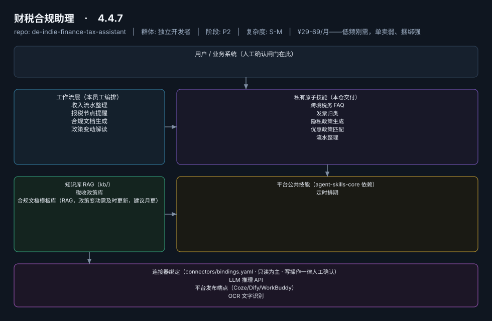
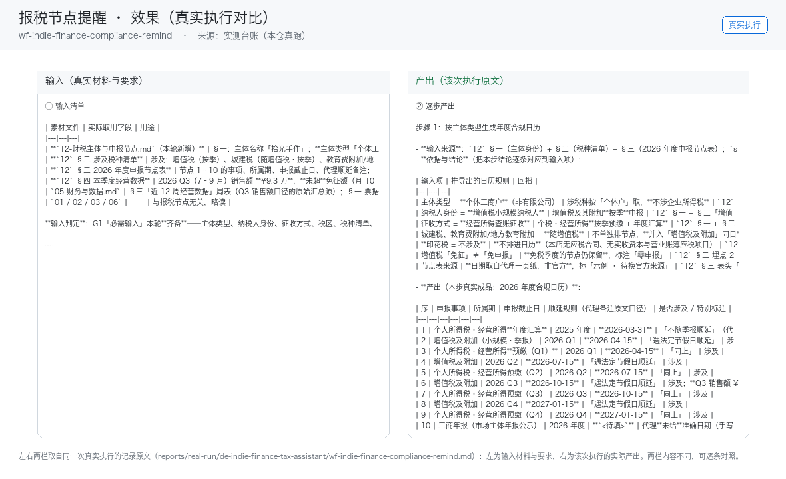

# 财税合规助理

> 一人公司的"合规哨兵"：节点不遗漏、文档不踩坑
>
> **4.4.7**　·　独立开发者　·　阶段 P2　·　
> 复杂度 S-M　·　¥29-69/月——低频刚需，单卖弱、捆绑强　·　定义卡 4.4.7

## 演示（真实执行录播）


*真实执行回放（GIF 自动循环，非摆拍）· [▶ 观看完整版 MP4](workflows/wf-indie-finance-compliance-remind/docs/images/08-demo-run.mp4) · 台账见 [`reports/real-run/wf-indie-finance-compliance-remind.md`](reports/real-run/wf-indie-finance-compliance-remind.md)*



## 效果（真实执行）



*上图为**真实效果对比**，不是示意图：左栏是输入材料与要求，右栏是该次执行的产出原文，
两栏取自同一次真实执行记录。*

- 完整台账：[`reports/real-run/wf-indie-finance-compliance-remind.md`](reports/real-run/wf-indie-finance-compliance-remind.md)
- 录屏与终端回放：[`workflows/wf-indie-finance-compliance-remind/docs/images/`](workflows/wf-indie-finance-compliance-remind/docs/images/)（`08-demo-run.gif` / `08-demo-run.mp4` / `04-terminal-run.png`）
- 使用示例：[`workflows/wf-indie-finance-compliance-remind/docs/使用示例.md`](workflows/wf-indie-finance-compliance-remind/docs/使用示例.md)
> 实测判定：**通过**　·　可用度 4/5　·　编造数字 0 处　·　红线命中 3 次 / 拦截 3 次


**一句话**：个体户/OPC 形态的全体独立开发者，尤其有跨境收款者

---

## 这个数字员工解决什么问题

一人公司的"合规哨兵"：节点不遗漏、文档不踩坑

| 项 | 内容 |
|---|---|
| 服务对象 | 个体户/OPC 形态的全体独立开发者，尤其有跨境收款者 |
| 可量化目标 | 报税/备案节点零遗漏；合规文档生成采纳率；政策变动 48h 内解读推送 |
| 投入产出 | 防漏报罚款 + 月省 3-5h，作为全家桶信任组件拉高续费 |
| 需求依据 | D03 |
| 分发渠道 | GitHub、闲鱼、淘宝 |

## 30 秒上手

```bash
git clone <本仓库地址> && cd de-indie-finance-tax-assistant
pip install pyyaml
python3 tests/run.py            # 先跑一遍自检，确认环境与契约都对得上
```

试用（把 `<输入>` 换成本人真实材料）：

```text
请以「财税合规助理」的身份，帮我跑「收入流水整理」。
材料如下：<输入>
要求：只使用材料里出现过的数字，缺的写 <待填>；对外文案停在待确认状态。
```

详细接入见 [`docs/01-安装与接入.md`](docs/01-安装与接入.md)。

## 仓库结构

```text
de-indie-finance-tax-assistant/
├── employee.md            # 人读定义卡（12 主字段 + 2 扩展组，由 employee.yaml 生成）
├── employee.yaml          # 机器契约（能力清单 + 依赖锁）
├── dependencies.yaml      # 对 core 的外部依赖（含版本）
├── persona/               # 运行提示词 / 边界 / KPI
├── skills/                # 私有原子技能（5 个）
├── spec-bindings/         # 有意不公共化能力的本地绑定声明（0 个）
├── workflows/             # 本员工工作流（4 条）
├── kb/                    # 知识库 RAG 契约
├── connectors/            # 连接器绑定（只读为主，写操作人工确认）
├── docs/                  # 六类发布文档
└── tests/                 # 自动化多场景测试
```

## 私有原子技能（5）

| 技能 | slug | 复杂度 | 阶段 | 成熟度 |
|---|---|---|---|---|
| `跨境税务 FAQ` | `crossborder-tax-faq` | S | P2 | 契约完备 |
| `发票归类` | `invoice-classify` | M | P2 | 已实现 |
| `隐私政策生成` | `privacy-policy-generator` | S | P2 | 契约完备 |
| `优惠政策匹配` | `promo-policy-matcher` | S | P2 | 契约完备 |
| `流水整理` | `statement-organize` | M | P2 | 已实现 |

## 平台公共技能依赖（1）

| 技能 | slug | 全平台复用员工数 |
|---|---|---|
| `定时排期` | `scheduled-dispatch` | 6 |

> 这些技能来自 `agent-skills-core@1.0.0`，本仓库**只引用不复制**。

## Spec 绑定层（0）

（无）

> 这一族能力**有意不公共化**（与外部平台接口强绑定）。本仓不存正文，
> 只留本地绑定声明与连接器配置。

## 工作流（4）

| 工作流 | slug | 触发 | 阶段 | 调用技能数 |
|---|---|---|---|---|
| `收入流水整理` | `wf-indie-finance-monthly-ledger` | 定时（每月） | P2 | 2 |
| `报税节点提醒` | `wf-indie-finance-compliance-remind` | 定时 | P2 | 1 |
| `合规文档生成` | `wf-indie-finance-doc-gen` | 人工 | P2 | 1 |
| `政策变动解读` | `wf-indie-finance-policy-digest` | 事件（政策发布） | P2 | 2 |

## 知识库与连接器

- 知识库语料：['税收政策库', '合规文档模板库（RAG，政策变动需及时更新，建议月更）']
- 连接器：LLM 推理 API、平台发布端点（Coze/Dify/WorkBuddy）、OCR 文字识别、支付平台流水

## 质量与验收

| 项 | 值 |
|---|---|
| 技能文件数 | 210 |
| 多场景用例数 | 248 |
| 用例通过 | 248 |
| 验收结论 | ✅ 通过 |

完整报告：[`docs/05-验收与测试.md`](docs/05-验收与测试.md)

## 许可

专有许可，详见 [`LICENSE`](LICENSE)。
