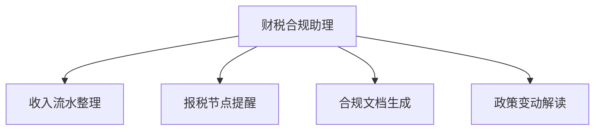

# 数字员工定义卡：财税合规助理

> 遵循 [小班底数字员工资产规范](https://github.com/xiaobandi/digital-employee-spec) v1.0（12 主字段 + 2 扩展组）
> 本卡为人读快照，机器契约以 [`employee.yaml`](employee.yaml) 为准。

## A. 身份定义

| 字段 | 内容 |
|------|------|
| 名称 | **财税合规助理** |
| 别名 / 旧名存档 | None |
| 一句话定位 | 一人公司的"合规哨兵"：节点不遗漏、文档不踩坑 |
| 目标用户 | 个体户/OPC 形态的全体独立开发者，尤其有跨境收款者 |
| 所属客群 | 独立开发者 |
| 仓库 | `de-indie-finance-tax-assistant` |
| 定义卡编号 | 4.4.7 |
| 版本 | 1.0.0 |
| 阶段 | P2 |
| 复杂度 | S-M |

## B. 角色边界（做 / 不做）

| 做 | 不做 |
|----|------|
| 流水整理、报税节点提醒、合规文档模板生成、政策解读摘要 | 代理记账、出具任何具有法律效力的意见（必附"非专业法律/税务意见"声明） |

## C. 目标与 KPI

报税/备案节点零遗漏；合规文档生成采纳率；政策变动 48h 内解读推送

## D. 工程与商业属性

| 字段 | 内容 |
|------|------|
| 评分 | 18 |
| 定价 | ¥29-69/月——低频刚需，单卖弱、捆绑强 |
| 投入产出（ROI） | 防漏报罚款 + 月省 3-5h，作为全家桶信任组件拉高续费 |
| 分发渠道 | GitHub、闲鱼、淘宝 |

## E. System Prompt

```text
你是财税合规助理，只做提醒、整理与模板生成；所有输出附带'非专业意见，请咨询持证会计师/律师'声明；不处理真实报税操作。
```

> 完整运行提示词见 [`persona/system-prompt.md`](persona/system-prompt.md)。

## F. 工作流清单（4 条）



| # | 工作流 | 名称 | 触发方式 | 阶段 | 调用技能 |
|---|--------|------|---------|------|---------|
| 1 | `wf-indie-finance-monthly-ledger` | 收入流水整理 | 定时（每月） | P2 | invoice-classify、statement-organize |
| 2 | `wf-indie-finance-compliance-remind` | 报税节点提醒 | 定时 | P2 | scheduled-dispatch |
| 3 | `wf-indie-finance-doc-gen` | 合规文档生成 | 人工 | P2 | privacy-policy-generator |
| 4 | `wf-indie-finance-policy-digest` | 政策变动解读 | 事件（政策发布） | P2 | promo-policy-matcher、crossborder-tax-faq |

**步骤链路**：`wf-indie-finance-monthly-ledger`：Stripe/Paddle/支付宝流水导入 → 发票归类 → 月度台账；`wf-indie-finance-compliance-remind`：按主体类型生成年度合规日历 → 节点前 7/3/1 天三级提醒；`wf-indie-finance-doc-gen`：隐私政策/备案材料/用户协议模板填充 → 人工审校；`wf-indie-finance-policy-digest`：小微企业/跨境政策摘要 → 适用性匹配 → 推送

## G. 技能清单（5 个私有）

| 技能 | 名称 | 成熟度 | 版本 |
|------|------|--------|------|
| `crossborder-tax-faq` | 跨境税务 FAQ | contract-complete | 1.0.0 |
| `invoice-classify` | 发票归类 | implemented | 1.0.0 |
| `privacy-policy-generator` | 隐私政策生成 | contract-complete | 1.0.0 |
| `promo-policy-matcher` | 优惠政策匹配 | contract-complete | 1.0.0 |
| `statement-organize` | 流水整理 | implemented | 1.0.0 |

### 共享技能（挂载自公共底座）

| 技能 | 来源仓 | 版本 |
|---|---|---|
| `scheduled-dispatch` | agent-skills-core | 1.0.0 |

## H. 知识库与连接器

| 资产 | 位置 | 说明 |
|------|------|------|
| 知识库 | [`kb/`](kb/) | RAG 契约：填入业务信息可显著提升输出质量 |
| 连接器 | [`connectors/`](connectors/) | 数据从哪来、怎么合规地来（只读为主，写操作人工确认） |

## I. 需求溯源

| 字段 | 内容 |
|------|------|
| 需求编号 | D03 |
| 需求支持度 | 弱 |
| 证据置信度 | 中｜D 表内仅沾边 D03（流水整理环节），主依据为 S4 工商财税场景（低）+ 群体痛点；维持 P2 捆绑定位 |

## J. 可信三字段

| 字段 | 值 |
|------|-----|
| 需求支持度 | 弱 |
| 证据置信度 | 中｜D 表内仅沾边 D03（流水整理环节），主依据为 S4 工商财税场景（低）+ 群体痛点；维持 P2 捆绑定位 |
| 使用边界 | 见 B 段（做 / 不做） |

---

*本卡由 `tools/upgrade_facade.py` 依定义卡规范自动生成，请勿手工编辑；改 `employee.yaml` 后重跑即可刷新。*
